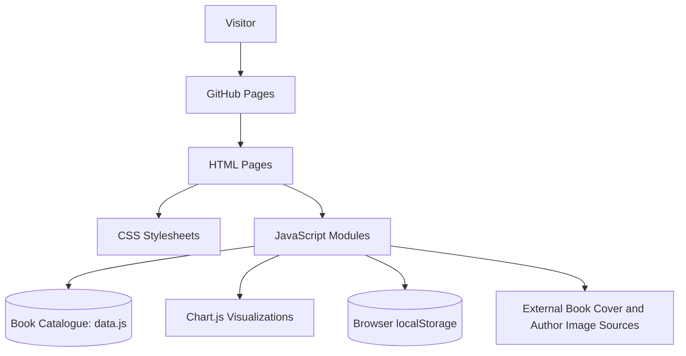

<div align="center">

# 📚 Bestselling Books

**A book discovery and data exploration website for bestselling books.**

<p>
  <a href="https://aadaadaad8.github.io/IT-first-project/">🌐 Live Website</a>
  &nbsp;·&nbsp;
  <a href="https://www.kaggle.com/datasets/drahulsingh/best-selling-books">📊 Dataset</a>
  &nbsp;·&nbsp;
  <a href="https://github.com/aadaadaad8/IT-first-project">💻 GitHub Repository</a>
</p>

**Book Catalog** &nbsp;·&nbsp; **Sales Insights** &nbsp;·&nbsp; **Book Recommendations** &nbsp;·&nbsp; **Saved Books**

</div>

---

## Motivation

Finding a book to read can be difficult when information about bestselling titles is spread across different sources. A large catalogue can also make it hard to compare books, explore publication trends, or discover titles that match a reader's interests.

**Bestselling Books** brings this information together in one browser-based website. It provides a searchable book catalogue, visual summaries of sales data, individual book details, and a bilingual recommendation assistant that helps visitors discover titles from the project's book list.

## Project Overview

The project is a static, multi-page web application. It runs in the browser and does not require a custom backend or database server. The book records used by the website are stored in `data.js` and loaded by the page scripts.

| Section | What it does |
|---|---|
| **1. Book catalogue** | Displays bestselling titles and lets visitors search by book title, author, genre, or original language. Books can be explored in different display layouts. |
| **2. Sales insights** | Visualizes the best-selling titles, estimated sales by decade of first publication, and sales distribution by original language. |
| **3. Book assistant** | Accepts English or Persian descriptions of reading interests and recommends matching books from the catalogue. |
| **4. Book details** | Shows information such as author, first publication year, original language, genre, estimated sales, and sales rank within the dataset. |
| **5. Saved books** | Lets visitors keep a personal list of books in their browser using local storage. |

## Website Preview

The published website is available here:

<p align="center">
  <a href="https://aadaadaad8.github.io/IT-first-project/">
    <strong>Open Bestselling Books</strong>
  </a>
</p>

## System Overview

The website is organized into four main user-facing areas:

- **Explore books:** Browse the catalogue, search for titles, switch between available layouts, and open a book's detail page.
- **Analyze sales:** Explore a top-10 bestseller chart, a decade-based comparison of estimated sales and book counts, and a chart showing sales by original language. The chart search field filters the top-10 results.
- **Get recommendations:** Describe a preferred genre, topic, author, or book-related interest in English or Persian. The assistant scores matching catalogue entries and displays up to three recommendations, with links to the catalogue and detail pages.
- **Save favourites:** Bookmark books and return to the saved-books view later in the same browser.

## Architecture



The application is client-side: HTML defines the pages, CSS handles their presentation, and JavaScript loads the catalogue and implements the interactive features. Chart.js is loaded from a CDN for the analytics page. Browser local storage is used for saved books and image caches.

## Book Catalogue and Data

The project uses the Kaggle **Best Selling Books** dataset as its data source:

- **Dataset:** [Best Selling Books on Kaggle](https://www.kaggle.com/datasets/drahulsingh/best-selling-books)
- **Dataset publisher:** D Rahulsingh
- **Data used by the website:** book title, author(s), original language, first publication year, approximate sales in millions, and genre.

The application reads its catalogue from `data.js`. Sales figures are approximate estimates from the dataset; they should not be interpreted as live or real-time sales statistics. Some records may not contain a genre value.

## Book Recommendation Assistant

The Book Assistant supports both Persian and English input. It recognizes a predefined set of topics and genre-related keywords, looks for matching information in the catalogue, and ranks possible recommendations using a local scoring method.

This is a **rule-based recommendation feature implemented in JavaScript**. It does not send prompts to an external generative-AI service or require an API key. When no suitable match is found, it can offer highly ranked books from the available catalogue as fallback suggestions.

## Data Visualization

The Sales Insights page uses [Chart.js](https://www.chartjs.org/) to present three views of the dataset:

1. **Top 10 Best-Selling Books:** compares the ten titles with the highest approximate sales in the catalogue.
2. **Sales by Decade of First Publication:** compares estimated total sales and the number of books across publication decades.
3. **Sales by Original Language:** displays the estimated sales distribution across languages, grouping smaller categories together.

## Technology

- **Structure:** HTML5
- **Styling:** CSS3
- **Application logic:** Vanilla JavaScript
- **Charts:** Chart.js
- **Browser storage:** `localStorage`
- **External data services:** Open Library for book-cover images and the Wikipedia REST API for author images
- **Hosting:** GitHub Pages

## Project Structure

```text
IT-first-project/
├── index.html          # Main book catalogue
├── books.html          # Additional book listing page
├── charts.html         # Sales analytics and charts
├── assistant.html      # Book recommendation assistant
├── detail.html         # Individual book details
├── data.js             # Book catalogue used by the website
├── books.js            # Main catalogue interactions
├── table.js            # Table/list interactions
├── insights.js         # Chart calculations and rendering
├── assistant.js        # Bilingual recommendation logic
├── detail.js           # Book detail page logic
├── *.css               # Page stylesheets
└── background.jpg      # Shared visual asset
```

## Run Locally

The project does not require a build process or package installation. To run it locally:

1. Clone the repository:

   ```bash
   git clone https://github.com/aadaadaad8/IT-first-project.git
   ```

2. Open the project folder:

   ```bash
   cd IT-first-project
   ```

3. Start a local static server (for example, with Python):

   ```bash
   python -m http.server 8000
   ```

4. Open **http://localhost:8000** in your browser.

You can also open `index.html` directly, but using a local server is recommended for a more consistent browser experience. Some visual resources, including book covers, author photos, fonts, and Chart.js, are loaded from external services and therefore require an internet connection.

## Collaborators

1. **Tahere Nazari** — First contributor
2. **Amir Mohammad Ghaemi Tabar** — Second contributor
3. **Faeze Arabshahi** — Third contributor
4. **Amirali Dorostkar** — Fourth contributor

## Deployment

The project is published using **GitHub Pages**.

- **Live website:** [https://aadaadaad8.github.io/IT-first-project/](https://aadaadaad8.github.io/IT-first-project/)
- **Source repository:** [https://github.com/aadaadaad8/IT-first-project](https://github.com/aadaadaad8/IT-first-project)

---

<p align="center">
  Made as an educational web project by the Bestselling Books team.
</p>
